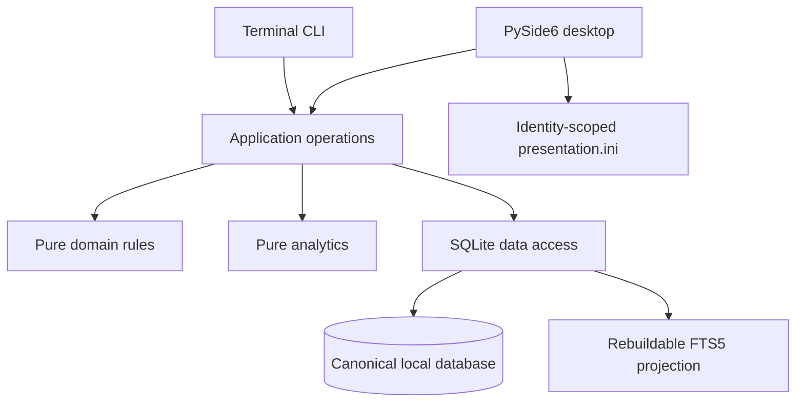

# Reckonsolve architecture

Unreleased working tree: Journal/workspace, New Prediction/Prediction Detail and the comprehensive Performance/ordinary Settings implementation, schema 21, search projection 3, CSV format 6. Journal/Detail walkthroughs are [accepted with recorded limits](archive/releases/2026-11-11-prediction-detail-verification.md#reported-detail-completion-acceptance--2026-11-12); the third slice is [accepted with recorded limits](archive/releases/2026-11-12-performance-settings-verification.md#reported-slice-3-acceptance--2026-11-12). Journal relocation is [accepted with recorded limits](archive/releases/2026-11-12-journal-relocation-verification.md#reported-slice-4-acceptance--2026-11-12). Released v0.8.0 remains the schema-20/format-5 baseline.
Last reviewed: 2026-11-13.

The [product specification](product-spec.md) governs behavior. This document describes implemented boundaries. Detailed decisions are in [ADRs](decisions/README.md); the earlier chronological account is preserved in the [architecture archive](archive/architecture-through-v0.8.md).

## 1. System context

Reckonsolve is a native Windows, single-user, offline desktop journal with a companion CLI. Python 3.13 is managed by uv. PySide6 is the runtime UI dependency; persistence and CLI parsing use the standard library. pytest, pytest-qt, and Ruff are development tools. Pinned PyInstaller is isolated in the packaging dependency group for private builds.

Presentation collects and renders values. Application operations coordinate use cases. Domain rules and analytics do not depend on Qt or open databases. Data access owns SQL, row mapping, migration, and transactions. Lower layers never import presentation modules. Prefer explicit modules and data flow over service containers or speculative infrastructure.

## 2. Composition and identities

`app.py` composes QApplication, Database, PredictionOperations, presentation settings, and MainWindow into ApplicationRuntime. `cli.py` composes a command's Database and the same operations into CliRuntime without constructing the desktop UI. Both close persistence deterministically, including after expected failures.

| Entry points | Identity | Data directory |
| --- | --- | --- |
| reckonsolve; python -m reckonsolve; reckonsolve-cli / rsc | Stable | %LOCALAPPDATA%\Reckonsolve |
| reckonsolve-dev; reckonsolve-cli-dev / rscd | Development | %LOCALAPPDATA%\Reckonsolve Dev |

Identity is selected before path resolution. Each fixed bootstrap initially contains reckonsolve.sqlite3. It retains presentation.ini plus format-1 identity/location/move records and the runtime lease after relocation. The active database may move to a reviewed unused local NTFS folder. Tests/private smoke inject explicit temporary files, bypassing user bootstrap entirely, or inject a complete disposable managed bootstrap. Normal commands do not offer arbitrary database selection, discover test paths, fall back to another identity, or copy data between identities. CLI help/version opens no database.

`paths.open_runtime_location` supplies the same identity-first resolver to GUI/CLI. `data/journal_location.py` validates bootstrap identity, locator, move phase, ownership and generation; missing/unknown state does not initialize another journal. Managed existing paths pass `allow_create=False` to `Database.open`: SQLite `mode=rw` prevents creation races, and recognized migration-history preflight rejects empty/unrelated files before upgrade/initialization. Only a missing default in an uninitialized profile may be created. Valid supported older recovery copies keep ordinary upgrade/refusal rules.

`data/location_native.py` owns narrow Win32 shared-runtime/exclusive-move leases, source/destination write fencing, file identity and fixed-NTFS/alias validation, persistent read-only protection and flushed same-directory metadata installation. `data/relocation_snapshot.py` owns checked read-only complete images and exact recovery/copy verification. `application/relocation.py` coordinates review, phase changes, source protection and explicit recovery; SQL stays in data modules. The [relocation ADR](decisions/0023-native-journal-relocation-and-recovery.md) records the ordering and limitations. No SQL schema, migration, dependency or scoring change is needed.

The GUI drains read requests and closes its SQLite connection/shared lease before exclusive movement. A failed unprotected move reacquires the unchanged location and reconnects the same Database object, preserving repository references. A protected/uncertain failure blocks data actions. Completion re-resolves and verifies the installed journal before recording completion. `app.run` closes the old runtime and constructs a fresh window/database/workspace using the same QApplication/identity; it does not guess a shell launcher. Stored appearance/geometry remain in fixed bootstrap; retrieval/report/draft state is fresh. CLI startup refuses pending recovery and identifies its move record; the matching updated GUI provides recovery review. The GUI's explicit Keep current location / Verify and finish move actions never choose a copy on failed verification.

An installed uv tool is a source snapshot independent of ongoing checkout edits. Matching GUI/CLI processes share local SQLite directly; normal refresh/navigation/restart observes another process's successful write. There is no watcher, daemon, synchronization ledger, API, or hosted service.

## 3. Module responsibilities

Paths below are relative to src/reckonsolve/.

| Boundary | Main modules | Responsibility |
| --- | --- | --- |
| Composition | app.py, cli.py, identity.py, paths.py | Identity, lifetime, entry points, injected clock/paths. |
| Application | application/predictions.py, application/quantiles.py, application/one_shot.py, application/reflection.py | Complete actions, reviewed-context checks, read models, expected-error translation and reflection-only delegation preserving terminal facts. |
| Domain | domain/forecast_contracts.py, domain/predictions.py, domain/quantiles.py, domain/one_shot.py | Closed identities, lifecycle/time rules, exact values, complete statements and documentary times. |
| Persistence | data/database.py, data/migrations.py, data/predictions.py, data/quantiles.py, data/one_shot.py | Connections, immutable schema history, model-aware transactions and reads. |
| One-Shot replay | data/one_shot_facts.py, data/one_shot_archive.py | Independently checked original/correction replay and effective archive facts. |
| Retrieval | application/journal.py, data/journal.py, domain/journal.py, data/search_index.py, data/search.py, data/tags.py | Checked Journal facts, faithful matching/order/counts, derived projection and tag transactions. |
| Workspace | ui/main_window.py, ui/workspace_state.py, ui/workspace_toolbar.py, ui/creation_task.py, ui/appearance.py | Composition, task sources, eligible controls, retained creation and presentation preference. |
| Journal widgets | ui/journal/ | Separate applied state, filter drafts, one-worker request coordination, controls and rows/excerpts. |
| Creation and Detail | ui/creation_screen.py, ui/binary_detail.py, ui/numeric_detail.py, ui/one_shot_detail.py, ui/prediction_detail.py | Mode-specific composition and reading; the small host dispatches the four contracts. ui/screens.py retains imports for existing callers. |
| Detail components/tasks | ui/prediction_contracts.py, ui/prediction_widgets.py, ui/detail_workspace.py, ui/detail_reading.py, ui/numeric_interval.py | Narrow view/operation contracts, committed presentation, Timeline helpers, exact interval labels, independent panes and one guarded writing task. |
| Focused forms | ui/prediction_dialogs.py, ui/dialog_review.py, ui/contextual_forms.py, ui/reflection_editor.py, ui/revision_fields.py, ui/editor_feedback.py | Existing operation-backed forms, internal review, contextual embedding, current/draft alignment and retained-input failure feedback. |
| Upgrade | data/upgrade.py, data/journal_migration.py, data/writer_contract.py | Protected recovery/review, ordered schema 21 and persistent stale-writer exclusion. |
| Analytics | analytics/trajectory.py, analytics/quantiles.py, analytics/one_shot.py and aggregate modules | Exact selection/scoring and separate observation populations. |
| Transfers | data/transfer.py | Verified online backup and snapshot-based CSV ZIP. |
| Desktop | ui/ | Screens/dialogs, shared styles/icons, charts/text alternatives, notifications and preferences. |
| Terminal | cli_creation.py, cli_mutations.py, cli_one_shot.py | Human prompts/rendering through shared operations. |

`data/numeric_predictions.py` remains shared supported storage infrastructure; its historical name is not permission to restore interval-v1 behavior. Historical migration SQL remains immutable even where its original runtime model has been retired.

## 4. Compatibility and migrations

The supported matrix is closed:

| Mode / type | Forecast model | Scoring contract |
| --- | --- | --- |
| Adaptive Binary | binary-trajectory-v1 | binary-trajectory-brier-v1 |
| Adaptive Numeric | numeric-quantiles-5-v2 | numeric-wis-v1 |
| One-Shot Binary | binary-one-shot-v1 | binary-one-shot-brier-v1 |
| One-Shot Numeric | numeric-one-shot-5-v1 | numeric-one-shot-wis-v1 |

Adaptive is presentation terminology; canonical mode deadline remains unchanged. CLI --mode adaptive maps to it, and --mode deadline remains an alias. One-Shot uses canonical one_shot. Model/scoring identity is immutable canonical data, not inferred from package version, metadata_version, or table population.

Startup, migrations, ordinary reads/writes, repair, backup, and export enforce compatible identities. Any retired-only or mixed-with-retired archive, missing/unknown/mismatched pair, unsupported schema, or malformed history fails clearly without conversion, deletion, repair, or partial loading. Compatibility checks occur before mutation and surround shared transactions. No startup failure silently replaces an existing database. See [ADR 0019](decisions/0019-retire-legacy-runtime-without-rebuilding-history.md).

Migrations are lightweight, ordered, history-validated, transactional, foreign-key checked, and covered by rollback tests. Already-applied migration SQL is never edited. Supported Binary schema-16/17 and supported schema-18/19 archives upgrade through schema 21 preserving forecasting history; deprecated Saved View configurations use the recovery/review boundary below.

- Schema 16 stores immutable contracts and prospective exact times.
- Schema 17 supports trajectory terminal correction/read integration.
- Schema 18 adds immutable five-quantile definitions/revisions and explicit shared anchors.
- Schema 19 adds two One-Shot pairs, documentary times, and transcription snapshots.
- Schema 20 historically adds nullable, constrained Saved View forecast_mode.
- Schema 21 retires those configurations after verified recovery/review and adds closed One-Shot correction source_action.

[ADR 0022](decisions/0022-reviewed-journal-upgrades-and-writer-guards.md) records exclusive transition/recovery, persistent per-connection writer guards, cancellation and failure behavior. No personal upgrade or journal relocation is implied by the local implementation.

Historical tables needed for supported storage/migration are not extra supported runtime contracts.

## 5. Canonical history and transactions

One standard-library sqlite3 connection per runtime enables foreign keys, a five-second busy timeout, and explicit immediate write transactions. Reads requiring a coherent history or aggregate use one checked snapshot. Independent processes may read simultaneously; sequential writes are the intended workflow. Lock/stale failures are bounded and never silently overwrite, merge, or retry indefinitely.

Each mutation rechecks ownership, current model, lifecycle, reviewed revision/metadata/correction tokens, and action-specific constraints under transaction access. System time is sampled at the authoritative commit boundary. Dirty searchable text is projected before commit; canonical writes and their search changes commit or roll back together.

Atomic units include:

- Creation: Prediction, immutable identity/definition, initial complete forecast, metadata/tags, and optional One-Shot answer.
- Adaptive revision/Review: current eligible anchor and clock checks, then one immutable record.
- Journal: current forecast anchor plus one immutable entry; body correction appends a version without moving the entry.
- Metadata: permitted current fields, protected Definition snapshot when required, tags/search, and concurrency token.
- Resolution/Invalidation: one immutable terminal decision; correction appends before/after facts with reviewed-current checks.
- One-Shot Add Answer: first original answer and documentary report, without another forecast.
- One-Shot Correct Transcription: complete validated before/after snapshot and app timestamp.
- Postmortem Skip: one immutable completion, with Resolved/blank/reflection-context checks.
- Tag maintenance: confirmed relationships, stable references, metadata tokens, and all affected search documents.
- Guarded Delete: revalidated untouched Open parent and its eligible child rows, without orphans.

Expected errors are translated to clear application failures; unexpected exceptions are not suppressed. One-Shot writes, metadata saves, Numeric Journal corrections and Numeric invalidation construct their complete responses before commit, avoiding a later read that could fail after a successful save. Creation and correction forms never request scores before Save.

## 6. Adaptive history and scoring

Exact event instants are canonical UTC text. Adaptive t0 is sequence-one commit, T the immutable Deadline, R the latest effective resolution instant, and C=min(R,T). T must exceed t0. Revisions are system-timestamped, strictly ordered, and commit before T; Reviews also stop at T. A regressed clock rejects the write instead of fabricating time. At T a nonterminal record is Locked.

Resolution's recorded-at is immutable system time. Effective R is the earliest defensible fixed/ascertainable instant and cannot exceed original recorded-at. Outcome/value/time changes require an explanation and append terminal history. Forecasts at/after C remain visible but unscored. R<=t0 yields an explicit no-score state.

Binary scoring uses exact microsecond standing durations and Fraction-valued Trajectory Brier, with the fixed T-t0 denominator and 0.25 neutral truncation after early R. Neutral truncation never creates a revision. Initial/Final/Hold-initial/Updating Gain and Active Forecast Fraction are diagnostics. Aggregate means give one equal vote per eligible Prediction; final-probability calibration is separate.

Numeric definitions fix unit, precision, and continuous-style/whole-number semantics. Complete immutable rows hold five scaled integers ordered q05<=q25<=q50<=q75<=q95. Journals, Reviews, and original Resolutions have one explicit model-appropriate revision anchor. Scoring derives the last complete revision strictly before C; a captured anchor is audit context, not selection authority. WIS is exact, with no trajectory or neutral contribution. Initial/Final/Delta comparisons are individual; aggregate improvement uses direction counts only.

Continuous-style calibration uses inclusive frequencies and pointwise 95% Wilson intervals. Whole-number calibration preserves strict/inclusive ties and inclusive 50%/90% outcome balances. No raw WIS/Delta mean or interpolated CDF observation is produced. See [ADRs 0017](decisions/0017-derive-trajectory-scores-from-terminal-facts.md) and [0018](decisions/0018-five-quantile-revisions-and-shared-anchors.md).

## 7. One-Shot persistence and replay

One-Shot records one final guess before checking an existing answer. There is no Deadline, normal revision/Review, cutoff selection, trajectory, or updating metric. Reported forecast/reveal wall minutes, approximation flags, and optional offsets are documentary. System app-entry/correction instants are separate audit facts. Neither timing source selects score observations.

Original forecasts reuse sequence one in supported revision tables. Original answers reuse type-specific Resolution tables with null effective time. one_shot_forecast_times and one_shot_answer_times store optional reports. one_shot_corrections stores full relational before/after snapshots with per-Prediction sequence, app time, optional note and immutable source_action. Historical/default transcription repairs never create Journal recency. Only the dedicated reflection-only Postmortem operation can mark a blank-to-nonblank reflection as new work; edits and clears remain repairs.

SQL/domain guards enforce immutable originals, single-forecast cardinality, no Reviews, current-before snapshots, and exact ordered/integral quantities. Checked read-only original/effective projections replay corrections, including a forecast corrected before a later first answer. A blank answer in an earlier correction cannot erase that later answer. [ADR 0021](decisions/0021-one-shot-originals-and-transcription-snapshots.md) records the layout.

analytics/one_shot.py computes pure exact Brier/WIS from one effective forecast and answer. AnalyticsRepository.get_one_shot_source reads contracts, validated replay, and tags in one checked transaction. application operations pass that source to analytics/one_shot_aggregate.py. Each answered, non-Invalid Prediction counts once; duplicate IDs are rejected. Separate Binary mean Brier/calibration and Numeric calibration reuse established bins, ties, and uncertainty. Adaptive loaders retain separate snapshots and denominators.

## 8. Retrieval, reflection, and derived state

Search projection 3 uses SQLite FTS5 fragments with stable source provenance. Canonical tables remain authoritative. A projector derives current/effective and optional superseded text; dirty documents refresh atomically with their source writes. Numeric values, scores, identities, and timestamps stay structured rather than becoming indexed prose.

The query boundary parses ordinary text, applies structured filters, evaluates same-Prediction word coverage, ranks explainably, and groups one row per Prediction. History-only matches are labeled and navigate to the correct source/version in Detail. Missing/stale/damaged derived state is a visible repair condition, never a false empty result. Repair changes no canonical history/time.

Saved Views have no runtime model, GUI, CLI or active tables after schema 21; the protected pre-upgrade copy retains earlier configurations. Tags remain reusable current relationships. Search/mode/date/attention filters are read-only; One-Shot has no fabricated Deadline or updating attention. The attention threshold remains configurable through CLI settings attention-days.

Journal reads admit the whole archive before filtering, reuse the existing corpus/ranking and build scoring-eligible summaries with shared score functions. Last active is derived from qualifying committed events and explicit reflection provenance. The current request publishes bounded rows and its full matching-Prediction count together. Enter/Search submits text; one worker owns its read-only connection, coalesces requests and discards obsolete completions. Edited text makes prior results unavailable; temporary failure, projection failure, archive refusal and successful zero results stay distinct.

Journals appear once at their original causal Timeline position, displaying current corrected text with collapsed edit history. Superseded matches open that history. Answered One-Shots share the Resolved-only Postmortem queue, Skip, and later reflection. All terminal originals and corrections stay inspectable.

## 9. Desktop presentation boundary

Journal presentation keeps a transient result-focus bookmark outside retrieval/canonical state. MainWindow asks for focus restoration on source-aware Journal returns; the Journal owner also detects replacement of a focused result during refresh. After layout/anchor restoration it focuses the originating visible Question or a current nearby target, with search/retry fallback. A different action during the asynchronous read owns focus; hidden pages cannot reclaim it. No newly reordered record is followed outside the restored browsing vicinity. Same-request reads retain readable rows and reuse unchanged widgets, including focused match disclosures; changed rows are replaced. New retrieval controls still mask the previous request, and failures clear retained success. Polling skips an already busy or hidden screen. Every refresh still performs checked archive admission and retrieval; this is presentation reuse, not a database-result cache. The [post-review record](archive/releases/2026-11-13-workspace-refinement-verification.md) records timing evidence and later reported refinement acceptance with its limits.

`ui/date_display.py` owns GUI date order and ordinary/exact time rendering. The root window supplies an identity-scoped date-format preference through widget ancestry; no mutable global preference or lower-layer UI dependency is introduced. `presentation.ini` stores DD-MM-YYYY, MM-DD-YYYY or YYYY-MM-DD (default) separately from the journal, retaining it across restart/relocation. Windows supplies the local zone; Settings exposes its name/current offset without an override. Ordinary timestamps omit offsets, while exact entry and terminal confirmation retain offset/DST cues. Reported One-Shot wall times retain their documentary offsets. Date-input presentation changes preserve native values and precision. Journal/Timeline widget reuse includes date-format/Windows-zone context, so unchanged canonical facts can be rendered again after presentation changes. CLI/default shared text and analytical formats remain unchanged.

`ui/numeric_interval.py` owns exact grouped labels, proportional marks and connector geometry. It coalesces font/style notifications from itself and its labels, then measures final metrics and updates the required height. Dynamic typography changes therefore reflow labels even when interval width is unchanged; values and mark positions retain their original exact meaning.

MainWindow centers the existing toolbar/page content inside a native horizontal layout. Shared `ContentWidth` tokens cap Journal at 1,024, Detail at 1,120 and Performance at 1,280 logical pixels; narrower windows use their available width and other routes restore the original unbounded shell constraint. Performance's paired/stacked layout and viewport-owned scope strip therefore follow the same bounded working area without changing report state. The notification host stays inside that area. The native window itself, saved geometry, page identities and task/scroll state remain unchanged.

Journal has row-specific Question, body/secondary/label and forecast typography in `ui/visual_system.py`. Questions use semibold emphasis above the shared Binary/Numeric forecast value size, while supporting labels/dates are larger than ordinary base text. Detail roles remain unchanged. Numeric rows use the existing FlowLayout for content-sized percentile/value groups with fixed gaps; extra viewport width stays after the groups, while long values reflow with their labels in the original order. FlowLayout advertises measured height-for-width without claiming surplus vertical expansion; a compact heading row cannot absorb a tall Timeline's empty height between its label and prose. No proportional interval or value rounding is introduced. TerminalSummary uses the shared compact chevron disclosure for its unchanged supporting forecast context, including scored and archival variants.

Journal's middle percentile label is simply 50th; Detail interval labels retain Median. WIS interval charts use dedicated actual-fill/outline colors so the diamond remains gold across appearances without changing warning-text contrast. One-Shot provenance disclosures contain equally padded raised panels. Unframed original/Before/After snapshot groups separate headings, dates and complete values; width-flexible labels retain height-for-width wrapping inside the border. Object identities and historical navigation remain unchanged.

Adaptive Overview's Probability History, More Information, Latest Committed Distribution and supporting scored-forecast wrappers all opt into the same compact disclosure. The existing reading-refresh owner still controls lifecycle visibility, fresh-visit collapse, exact reveal and ongoing-task retention; directly displayed nonterminal charts are unchanged. Dialog/edit actions remain ordinary actions.

Adaptive Numeric Detail places the supplied immutable Unit and Decimal Places in a wrapping two-field row below Resolution Criteria in every reading state. More Information owns only the remaining optional context/history; its empty state is distinct from unavailable definition history. This moves presentation widgets without changing application operations, canonical facts or precision.

ui/components.py supplies the shared Binary ProbabilityPresets. Adaptive and One-Shot creation use the same direct-entry row, with separate widget identities and no save action; contextual revision opts into wrapping. Compact presets and the shared New button reserve their focused border width so keyboard focus does not clip labels or change geometry.

ui/visual_system.py owns palette-relative typography, semantic colors, spacing, surfaces, badges, focus/disabled states, action roles, and restrained motion. Palette propagation may request several refreshes; unchanged stylesheet text is retained so each appearance change repolishes the workspace once. Semantic fonts still refresh for native font changes. No widget-local theme framework or domain/data dependency is introduced. Local Lucide assets and dropdown chevrons follow the packaged resource path; palette changes refresh colors and icons.

The chart/table comparison in ui/analytics_components.py coalesces surface synchronization until Qt finishes palette propagation and stylesheet repolishing. Its graph and table then use the same resolved panel surface; explicit child backgrounds cannot retain the previous appearance while text changes.

Page-title typography leads the Question role while preserving readable Question/forecast emphasis. Shared FlowLayout omits empty/hidden items from geometry and minimum sizing, so lifecycle-ineligible controls leave no stray spacing. Adaptive Timeline heading, Current Revision and order controls wrap together above the history scroll area; the independent pane proportions and jump target remain unchanged.

ui/detail_reading.py supplies the shared terminal summary. Resolved Adaptive headers render effective outcome/actual and the existing analytical score, with eligible forecast context on request. Invalid headers across both modes lead with the effective reason and Not scored, preserve the original decision date and distinguish later reason corrections. Open/Locked retain committed forecast headers. The component receives display-ready facts; it performs no score calculation, canonical writes or SQL.

ui/detail_sections.py owns Adaptive Resolution notes/Postmortem reading panels and terminal Timeline rows. Existing immutable recorded-at facts order Resolution, corrections, Skip and Invalidation alongside ordinary events; effective cutoff times never substitute for recording chronology. Current results have one prominent home, while complete original/corrected snapshots stay in collapsed history. Write/Edit Postmortem and eligible Skip share the action strip; factual repairs remain under More.

Its TimelineRows presentation state compares freshly read immutable events and rendering context, retains unchanged widgets, and replaces only changed rows. Current-revision/scoring-exclusion annotations participate in row identity checks. Order controls rearrange the loaded rows without database access; opening a writing task still refreshes canonical context and retains shared transaction/stale checks. Empty state clears the retained rows. Ordinary entry resets disclosures/search cues, while repeated exact reveals restart one cue timer per target.

Adaptive score details live in Overview without repeating the terminal header. Numeric scorecards expose individual median/interval feedback and retain the existing WIS breakdown on request. The current CDF is labeled Latest committed distribution and starts collapsed on terminal records, explicitly separate from an earlier eligible scoring forecast. It never renders a historical CDF. Narrow charts reserve room for complete endpoint/unit labels; revision headings and Journal history wrap without changing values or anchors.

Performance composition is owned by `application/performance.py`. `AnalyticsRepository.get_performance_sources` admits the complete archive and reads all three canonical source collections plus the full tag library in one read-only SQLite snapshot. The admission-produced One-Shot replay cache is reused. Existing pure trajectory, five-quantile and One-Shot aggregates compute four separate sections; no scoring algorithm, schema, migration or dependency changes. A selected stable tag resolves within that same snapshot. Verified deletion returns All tags with a notice; an unavailable exact unit remains a section error, never implicit broadening.

`ui/read_requests.py` coalesces immutable requests onto one worker and discards obsolete generations. Journal's existing retrieval wrapper and Performance share this coordination. Each Performance worker opens/closes its own read-only connection, without upgrades/repairs/writes or use of the UI connection. Expected read failures are visible; unexpected failures are logged and surfaced. The UI never displays prior-scope values as a new report. Only an identified analytical section failure is isolated; archive refusal blocks the workspace globally.

`ui/performance_state.py` holds session-only tag, independent Numeric units and reading position. `ui/performance_screen.py` coordinates refresh/reset, paired/stacked sections and one viewport-owned Tag/Reset strip pinned while the introduction scrolls away. `ui/performance_sections.py` renders the four existing analytical populations, primary Numeric interval/median balances, exact counts and uncertainty, with supporting percentile tables/diagnostics collapsed initially. These and Binary calibration tables reuse the shared compact chevron; their body identities, session retention and reset defaults remain. `analytics_screen.py` keeps the existing import name as an alias; migrated single-mode containers are removed. Settings tag operations emit confirmed stable-ID provenance; a known merge target replaces a selected source and expires an older background read.

`ui/settings_tools.py` owns each selectable latest tool result. `ui/settings_screen.py` composes appearance, Dates and Time, data-location facts, backup, analytical export, tags, search repair and shortcut guidance. Navigation clears visit-local results; minimization/recoloring do not. A dated receipt retains a presentation callback for date-order changes without rerunning the operation; leaving or starting another operation for that tool clears it. Canonical last-successful-backup metadata remains separate. Tag maintenance preserves confirmations/stale guards, emits no committed-change event on failure/cancel, retains failures beside its tool and routes archive refusal globally. The source coordinator preserves Performance's independent origin through Settings. `ui/location_controls.py` adds native folder selection, a scrollable selectable current/new/recovery review and persistent failures. It invokes shared application operations and explicit startup recovery; no SQL/file protocol lives in signal handlers.

Journal replaces Dashboard and the old browser. A compact shared toolbar offers prominent New, quiet Performance, appearance and Settings controls only on eligible pages. One task-source coordinator owns New/Performance/Settings origins; returning through Settings never overwrites Performance's independent origin. Detail returns to a refreshed Journal retrieval and a useful nearby anchor. No sidebar, peer tabs or general navigation stack remains.

Creation retains all four contracts, whole-task discard/save guards, mode inputs and the Journal/answered-Detail success landings. Numeric validation uses authoritative field errors beside retained forecast inputs. Performance and Settings use the report/tool owners described above. Journal relocation uses the separately authorized, tested location boundary above; its requested walkthrough is accepted with recorded limits. Final integrated acceptance remains separate.

Adaptive Detail keeps committed header/Deadline context above independent Timeline and Overview scroll areas. Open/Locked reading uses 60/40; Resolved/Invalid reading uses 50/50. Contextual writing uses 40/60, with Mark Invalid at 60/40. Main pane headings are TIMELINE and OVERVIEW or ARCHIVAL CONTEXT, with Title Case subsections. Task tabs suppress the duplicate inner Overview heading without discarding the saved context. A 180 ms pane transition follows Qt's animation preference and never gates input. During motion the real Timeline body keeps its current wrapping while its viewport boundary moves; normal wrapping and scrollbar policy resume once at completion. The editor stays live. Direction changes continue from the current proportion without an intermediate jump to an old animation endpoint. An outer fallback scroll preserves access with tall headers or short windows. Numeric intervals project exact scaled-integer ratios only for painting; grouped ties, selectable exact labels and connector leaders never alter canonical values. The Current Revision marker/jump targets the actual saved Timeline row; historical search opens the necessary disclosures and pane.

One-Shot Detail shares the independent two-pane workspace with content suited to one immutable forecast. The left pane contains results, inline later reflection, visible Journal Entries and disclosed Recorded History; the right contains context and disclosed originals/corrections/recorded facts. Waiting uses 60/40 and Resolved/Invalid reading uses 50/50. Shared surfaces, semantic status badges, headings and disclosure controls replace the former single-column reading composition. Contextual Journal/Invalid forms use the same task guard. Existing dialogs are embedded as nonmodal contextual forms where selected; saved signals continue invoking the canonical operations. Temporary Overview consultation retains entered revision values. Raw input fingerprints exclude presentation-only state; no persistent draft is written. No Adaptive updating, Deadline or trajectory workflow is added to One-Shot.

One-Shot's checked answer and full-width scorecard are stacked, with a prominent exact score, secondary interpretation and disclosed Numeric breakdown. Postmortem and Journal Entries are distinct unframed reading sections. The shared `collapse_section` compact option uses a content-width, keyboard-focusable native chevron control with palette-relative hover/focus; other callers retain their existing default. Exact historical reveal still opens the same body identity. Skipped reflection displays its immutable completion date and moves later writing into More; written reflection restores Edit and retains any earlier Skip. These are presentation states derived from existing facts, not new storage or completion rules.

Edit Details and Correct Transcription keep review and final consent inside one focused dialog, bound to the reviewed inputs and original concurrency token. Adaptive Resolution/Invalid preparation requires a separate explicit terminal confirmation. Nonblank reflection-only saves delegate unchanged effective terminal facts through shared operations; mixed factual corrections, clearing and Skip keep confirmation. One-Shot reflection uses the dedicated provenance operation. Failure retains inputs; Deadline rejection refreshes committed Locked context and provides a brief right-side notice plus a repeatable cue. User/history text remains selectable; charts remain committed-only.

Creation modes share canvas/card placement and reciprocal top-right One-Shot/Adaptive actions with draft retention. One-Shot shows Background/Rationale/Tags in the main card and optional separate date/segmented time input. ui/time_input.py adapts native QTimeEdit section entry, Tab/Shift+Tab, A/P, and Up/Down. UTC is a neutral Qt carrier for documentary wall time, not normalization of a reported event.

ui/exact_deadline_input.py resolves Adaptive local shortcuts/custom times using target-date zone rules. Repeated hours require an occurrence choice; gaps reject. Explicit-offset override remains. Required heading, selected summary, and validation remain; guidance expander, unset prompt, and explanatory footer are absent. [ADR 0020](decisions/0020-resolve-local-deadlines-explicitly.md) explains the time boundary.

Desktop Answer Pending uses warning yellow for the unchanged One-Shot Open state; shared CLI text remains Waiting for answer. Needs Postmortem is informational blue, Resolved success green. Mark Invalid is orange Caution; Delete is red Destructive. Human-readable local-minute labels do not alter exact canonical instants.

The shared toolbar places an icon-only Journal action beside the right-hand utilities on Performance and Settings, with Journal tooltip/accessibility text. It invokes existing Journal navigation without resetting retrieval; the separate Back action still uses the workspace's independent source. It is hidden on Journal, Detail and creation and disabled by global archive refusal. Shared styling reserves the two-pixel focus border on both Reset View buttons, preserving full text and fixed geometry across focus changes.

Settings also exposes the existing Performance chart icon. `ui/workspace_state.py` derives its return origin from Settings' underlying Journal/Prediction source; returning from a Performance detour retains that report's independent origin. This avoids a Settings/Performance Back cycle within the existing one-source model. The ordinary report owner refreshes current results while retaining session scope, disclosures and useful position; leaving Settings still clears visit-local tool results.

Identity-scoped presentation.ini stores safe geometry/maximized state and Follow Windows / Light / Dark outside SQLite; obsolete sidebar preferences have no visible effect. Never restore a minimized/off-screen window. Notifications carry only already-verifiable routine success; errors/decisions remain persistent. Ctrl+N, Journal-only Ctrl+F and eligible Ctrl+, respect native modal decisions; creation hides unrelated destinations. Retired global navigation shortcuts are absent. Appearance updates the existing widget tree without rebuilding tasks or losing focus/selection; failed preference persistence is explicit. Icons and charts retain accessible names and text alternatives.

## 10. Backup, export, and private packaging

Online SQLite backup captures and verifies a temporary complete database before atomic installation, then records success metadata. It includes current settings, history, provenance and derived search state; presentation.ini remains separate. Supported recovery verifies migration history and derived projection. Unsupported originals remain unchanged.

CSV format 6 uses one checked read snapshot, fully quoted UTF-8 CSV, a verified temporary ZIP, and atomic replacement. It retains the 17 format-4 CSV layouts and adds one_shot_original_facts.csv, one_shot_effective_facts.csv, and one_shot_corrections.csv, plus the dictionary. Format 6 extends one_shot_corrections.csv with source_action; other file meanings and exact quantities remain. Numeric values remain scaled integers. Optional wall minutes/offsets are documentary; effective facts are a labeled derived convenience, not another observation. Empty exports retain all headers.

The dictionary explains relationships, nulls, exact quantities, model/scoring dispatch, correction replay, and later-answer handling. Scores, CDF points, settings, preferences and search rows are excluded. CSV is analytical, not restorable. Failure cannot replace a prior destination. Desktop and CLI share data/transfer.py.

Private Windows onedir builds include local styles/icons and run relocated disposable smoke checks with the bundled runtime. Public source releases ship no installer, signing, public executable, import API, or updater. Generated artifacts remain ignored.

## 11. Verification and evolution

Test pure rules/scoring separately from rendering. Disposable database coverage protects immutable history, rollback, concurrency, exact cutoff boundaries, correction replay, whole-number ties, supported upgrades, refusal-before-mutation, search repair, backup/export, and cross-interface restart. Snapshot tests distinguish presentation-only actions from writes. Human Windows review covers palettes, scaling, focus, keyboard, wrapping, and responsive sizes; offscreen tests do not replace it.

[Development and testing](maintainer/development.md) provides commands and disposable review profiles. [Search evaluation](maintainer/search-evaluation.md) records the method. [The release checklist](maintainer/release-checklist.md) provides repeatable gates. Dated evidence belongs in [the archive](archive/README.md).

M1-M60 are completed history, not an open implementation queue. New product work needs explicit user authorization and aligned specification/architecture. Preserve existing identities/history and record consequential decisions in ADRs; do not restore retired workflows to satisfy an old fixture or historical document.
